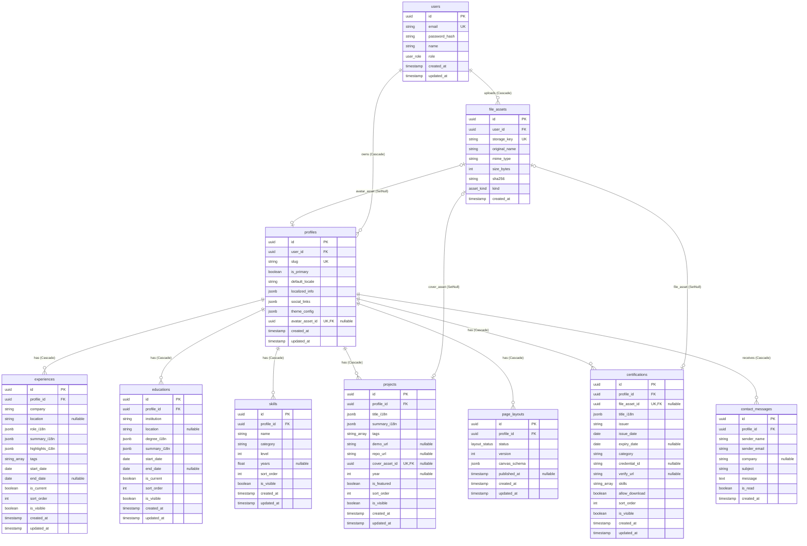

# 01 - Diagrama Entidad-Relación (ER)

Este diagrama representa con fidelidad el esquema relacional implementado en [schema.prisma](../../packages/database/prisma/schema.prisma) sobre **PostgreSQL 16**, usando los nombres físicos de tablas y columnas (`snake_case`).

---

## 1. Diagrama Entidad-Relación Completo (Nivel Físico/Lógico)

---

## 2. Matriz de Relaciones e Integridad Referencial

| Relación | Tabla Padre | Tabla Hija / Referenciante | Cardinalidad | Columna FK | Política `ON DELETE` | Garantía / Propósito |
| :--- | :--- | :--- | :---: | :--- | :--- | :--- |
| Propietario de perfiles | `users` | `profiles` | `1 : N` | `profiles.user_id` | `CASCADE` | Elimina perfiles asociados si se elimina la cuenta. |
| Cargador de activos | `users` | `file_assets` | `1 : N` | `file_assets.user_id` | `CASCADE` | Vincula todo binario al usuario propietario (`isOwner`). |
| Avatar de perfil | `file_assets` | `profiles` | `0..1 : 0..1` | `profiles.avatar_asset_id` (`UK`) | `SET NULL` | Un activo único opcional como avatar; si se borra el archivo, el perfil permanece intacto. |
| Portada de proyecto | `file_assets` | `projects` | `0..1 : 0..1` | `projects.cover_asset_id` (`UK`) | `SET NULL` | Imagen de portada opcional por proyecto sin borrar el proyecto si se retira la imagen. |
| PDF de certificación | `file_assets` | `certifications` | `0..1 : 0..1` | `certifications.file_asset_id` (`UK`) | `SET NULL` | Respaldo binario PDF 1:1 opcional por credencial. |
| Trayectoria laboral | `profiles` | `experiences` | `1 : N` | `experiences.profile_id` | `CASCADE` | Aislamiento por perfil y borrado limpio. |
| Trayectoria académica | `profiles` | `educations` | `1 : N` | `educations.profile_id` | `CASCADE` | Aislamiento por perfil y borrado limpio. |
| Portafolio | `profiles` | `projects` | `1 : N` | `projects.profile_id` | `CASCADE` | Aislamiento por perfil y borrado limpio. |
| Competencias | `profiles` | `skills` | `1 : N` | `skills.profile_id` | `CASCADE` | Aislamiento por perfil y borrado limpio. |
| Certificaciones | `profiles` | `certifications` | `1 : N` | `certifications.profile_id` | `CASCADE` | Aislamiento por perfil y borrado limpio. |
| Layouts del Studio | `profiles` | `page_layouts` | `1 : N` | `page_layouts.profile_id` | `CASCADE` | Historial versionado (`DRAFT`, `PUBLISHED`, `ARCHIVED`) por perfil. |
| Buzón de contacto | `profiles` | `contact_messages` | `1 : N` | `contact_messages.profile_id` | `CASCADE` | Mensajes recibidos dirigidos al perfil correspondiente. |

---

## 3. Reglas de Consistencia Adicionales (Capa Aplicación / API)

- **Unicidad de `slug` público:** `profiles.slug` posee restricción `UNIQUE` en PostgreSQL y verificación explícita en `PUT /api/admin/profile` respondiendo `409 Conflict` si otro perfil ya ocupa ese *slug*.
- **Limpieza física compensatoria en `file_assets`:**
  - En `POST /api/admin/certifications`: primero se valida y guarda el PDF vía `StorageProvider.put()`, luego se ejecuta `$transaction` (`FileAsset` + `Certification`); si falla SQL, se invoca `storage.remove(uploadedKey)` para evitar archivos huérfanos en disco.
  - En `DELETE /api/admin/certifications/[id]`: elimina en transacción `Certification` y su `FileAsset` asociado y posteriormente borra el binario físico con `storage.remove()`.
- **Control de publicación atómica en `page_layouts`:** `PUT /api/admin/layout` con `publish=true` marca los layouts `PUBLISHED` previos como `ARCHIVED` e inserta una nueva instantánea `PUBLISHED` dentro de la misma transacción.
