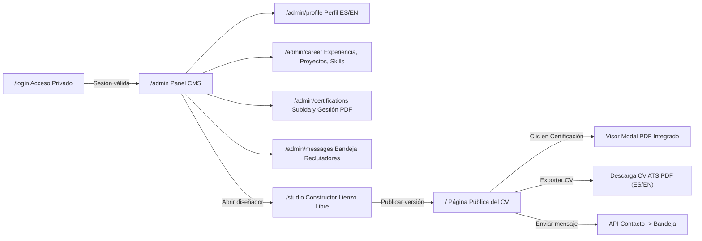

# Prototipo y Wireframes del Sistema
## Sistema Web de CV Interactivo con Constructor Visual de Lienzo Libre

**Versión:** 1.1 (Actualizado con dirección visual editorial inspirada en `ryoku.dev`)  
**Fecha:** 2026-11-21  
**Documentos relacionados:** [Visión y Alcance](./vision-y-alcance.md) · [SRS](./srs/README.md) · [Matriz de Trazabilidad](./matriz-trazabilidad.md) · [Paquete Diseño UI/UX (Guía de Estilo y Mockups SVG)](./ui-ux/README.md)  
**Prototipo interactivo navegable (HTML):** [Abrir prototipo interactivo](./prototipo/index.html)

---

## 0. Dirección Estética: "Editorial Obsidian & Bone" (Inspirada en `ryoku.dev`)

Como tema insignia por defecto del sistema (editable desde `/studio` en Fase 2), se adopta una estética **minimalista arquitectónica de alto contraste y precisión técnica**:

| Elemento | Especificación |
| :--- | :--- |
| **Paleta Oscura (Por defecto)** | Fondo `#000000` / superficie `#0a0a0a`, tinta cálida hueso `#cdc4ba`, metadatos atenuados `#958f87`, señal acento `#ce5e32` (con variantes intercambiables: *Void* `#6daf8c`, *Cobalt* `#6ea5cf`, *Indigo* `#9299d3`). |
| **Paleta Clara ("Bone Paper")** | Fondo `#f3efe9` / superficie `#faf8f4`, tinta `#171513`, líneas finas `1px` y acento `#ce5e32`. |
| **Tríada Tipográfica** | **Display:** `Fraunces` (editorial serif). **UI/Cuerpo:** `Space Grotesk`. **Metadatos, numeración e IDs:** `Space Mono`. |
| **Patrones de Composición** | Encabezados numerados (`01 // TRAYECTORIA`), líneas divisorias finas (`1px`), *Vitals Bar* para métricas, tablas *spec-row* de datos clave, *Spine* lateral de navegación rápida, bordes agudos (`--radius: 2px`) y movimiento intencional (`90ms–210ms` respetando `prefers-reduced-motion`). |

---

## 1. Mapa de Navegación y Flujos Principales



---

## 2. Wireframe 1: Acceso Privado (`/login`)
*Trazabilidad:* `RF-AUTH-01`, `RF-AUTH-02`, `HU-01`

```text
+-----------------------------------------------------------------------+
|                                                                       |
|                +-----------------------------------+                  |
|                |  [Icono Candado] Acceso Privado   |                  |
|                |  Administra tu CV y PDFs          |                  |
|                |                                   |                  |
|                |  Correo electrónico               |                  |
|                |  [ admin@proyecto-cv.local      ] |                  |
|                |                                   |                  |
|                |  Contraseña                       |                  |
|                |  [ •••••••••••••                ] |                  |
|                |                                   |                  |
|                |  [       Iniciar Sesión         ] |                  |
|                |  -------------------------------- |                  |
|                |     <- Volver a página pública    |                  |
|                +-----------------------------------+                  |
|                                                                       |
+-----------------------------------------------------------------------+
```

---

## 3. Wireframe 2: Panel CMS Control Center (`/admin`) — Arquitectura Hub Agrupada
*Trazabilidad:* `RF-DATA-01..05`, `RF-CERT-01..03`, `HU-02`, `HU-03`, `CU-01`

**Decisión de arquitectura visual (Por qué Rail Lateral Agrupado en Admin):**
- En la **Página Pública (`/`)**, la navegación va **arriba** (estilo editorial `ryoku.dev`) porque el visitante recorre un documento continuo.
- En el **Control Center (`/admin`)**, se adopta un **Rail Lateral Izquierdo agrupado (`256px`, estilo `ryoku-hub`)** + **Barra Contextual Superior** + **Workspace Maestro-Detalle**:
  - `GENERAL`: **00 Resumen & Salud** (tira de KPIs + checklist de traducción `ES/EN` + accesos rápidos).
  - `CONTENIDO DEL CV`: **01 Identidad ES/EN** (con vista previa Hero) · **02 Carrera & Stack**.
  - `BÓVEDA & MENSAJES`: **03 Bóveda PDF Certs** · **04 Bandeja** (vista dividida Lista izquierda / Lectura derecha).
  - `SISTEMA`: **05 Acceso & Versiones** (política single-tenant, límites PDF y snapshots).

```text
+-------------------+---------------------------------------------------+
| Control Center    | Control Center / 00 Resumen & Salud | [+PDF][Studio]|
| Alex Rivera       |---------------------------------------------------|
| GENERAL           | [Showroom: 3] [Stack: 5] [PDFs: 2] [No leídos: 1] |
| [x] 00 Resumen    |---------------------------------------------------|
| CONTENIDO DEL CV  | Salud Bilingüe (ES/EN)   | Acciones Rápidas       |
| [ ] 01 Identidad  | Perfil ES/EN     100% OK | [Abrir Studio IDE ->]  |
| [ ] 02 Carrera    | Certificados      2 / 2  | [Subir PDF]            |
| BÓVEDA & MENSAJES | Nodos Studio      6 blq. | [Agregar Proyecto]     |
| [ ] 03 Bóveda PDF |                          |                        |
| [ ] 04 Bandeja  1 |                          |                        |
| SISTEMA           |                          |                        |
| [ ] 05 Acceso     |                          |                        |
| [Abrir Studio ->] |                          |                        |
+-------------------+---------------------------------------------------+
```

---

## 4. Wireframe 3: Constructor Visual Studio (`/studio`) — Organización IDE Full-Bleed + Código
*Trazabilidad:* `RF-BUILDER-01..07`, `HU-05`, `HU-06`, `HU-07`, `CU-02`

### 4.1 Vista Desktop (Shell Edge-to-Edge con Modo `Diseño | Split IDE | </> Código`)

```text
+---------------------------------------------------------------------------------+
| mi-cv / [● DRAFT] | [Diseño|Split IDE|</>] [Desktop|Mob] [75%|100%] [⊞ Grid] | [↶][↷][👁][Publicar] |
+--------------------+------------------------------------------+-----------------+
| [+ Insertar|≡ Capas]|  [HUD Nodo: Duplicar | ↑Frente | 🔒 | 🗑] | [Diseño|Cont.|Tema]|
|                    |  0    160   320   480   640   800  960px |                 |
| [Buscar bloque...] |  +------------------------------------+  | Alineación:     |
|                    |  | [HERO DOSSIER (WYSIWYG REAL)]      |  | [←][↔][→][Full] |
| Primitivos Libres  |  +------------------------------------+  | X:[24]  Y:[24]  |
| [</> Código][Aa Txt]|  | [</> BLOQUE CÓDIGO (SHADOW DOM)]   |  | W:[912] H:[200] |
| [□ Card]  [↗ Botón]|  +------------------------------------+  | Superficie/Borde|
|                    |------------------------------------------| Radio: [2px]    |
| Widgets Conectados | [<> component.html] [# styles.css] [{ } canvas.json] | Snippets |
| [00 Hero] [01 Work]| 01 | <div class="term-box">              | [Abrir en IDE]  |
| [02 Exp]  [03 Tech]| 02 |   <div class="term-head">...</div>  |                 |
| [04 PDF]  [05 Mail]| 03 | </div>                              | [x] Vis. Móvil  |
+--------------------+------------------------------------------+-----------------+
| Artboard: 960×920px · Nodos: 6 · Sel: Hero | Ctrl+Z Deshacer · Ctrl+D Duplicar · Flechas 8px |
+---------------------------------------------------------------------------------+
```

### 4.2 Vista Mobile en el Studio (Apilado Inteligente Configurable)
*Trazabilidad:* `RF-BUILDER-04`, `HU-06`, `RNF-COMP-02`

```text
+-------------------------------------------------------------------------------+
| <- Admin | Studio · Vista Mobile (390px) · Reordenamiento de Apilado           |
+-----------------------------+-------------------------------------------------+
| ORDEN EN MÓVIL              |       VISTA PREVIA MÓVIL (390px)                |
|                             |       +-------------------------------+         |
| [↑][↓] 1. Controles    [x]  |       | [ES|EN] [Tema] [Descargar PDF]|         |
| [↑][↓] 2. Hero         [x]  |       +-------------------------------+         |
| [↑][↓] 3. Línea Tiempo [x]  |       | [Avatar] Nombre Completo      |         |
| [↑][↓] 4. Habilidades  [x]  |       | Titular · Estado · Redes      |         |
| [↑][↓] 5. Proyectos    [x]  |       +-------------------------------+         |
| [↑][↓] 6. Certific.    [x]  |       | Línea de Tiempo (1 columna)   |         |
| [↑][↓] 7. Contacto     [x]  |       +-------------------------------+         |
| [↑][↓] 8. Deco Banner  [ ]  |       | Skills filtrables (chips)     |         |
|  (Oculto solo en móvil)     |       +-------------------------------+         |
+-----------------------------+-------------------------------------------------+
```

---

## 5. Wireframe 4: Página Pública Interactiva (`/`) y Visor Modal PDF — Fase 3
*Trazabilidad:* `RF-PUB-01..04`, `RF-CERT-03..05`, `HU-04`, `HU-08`, `HU-09`, `HU-10`, `CU-03`

```text
+-------------------------------------------------------------------------------+
|  [CV Logo]                     [ ES | EN ]   [ Claro / Oscuro ]  [Exportar PDF]|
+-------------------------------------------------------------------------------+
|  +-------------------------------------------------------------------------+  |
|  | (Avatar)  NOMBRE COMPLETO                     [● Disponible para retos] |  |
|  |           Ingeniero de Software Full-Stack                              |  |
|  |           Resumen profesional bilingüe + [GitHub] [LinkedIn] [Email]    |  |
|  +-------------------------------------------------------------------------+  |
|                                                                               |
|  +-------------------------------------------+ +---------------------------+  |
|  | LÍNEA DE TIEMPO (Experiencia y Educación) | | HABILIDADES               |  |
|  | ● 2024-Act · Senior Dev @ Empresa A  [v]  | | [Todas][Frontend][Cloud]  |  |
|  | ● 2021-2024 · FullStack @ Empresa B  [>]  | | TypeScript  [=========-]  |  |
|  | ● 2017-2021 · Ing. Sistemas @ Univ.  [>]  | | PostgreSQL  [========--]  |  |
|  +-------------------------------------------+ +---------------------------+  |
|                                                                               |
|  +-------------------------------------------------------------------------+  |
|  | PROYECTOS   Filtrar: [Todos] [Next.js] [Docker] [IA]                    |  |
|  | +---------------------+  +---------------------+  +-------------------+ |  |
|  | | Proyecto 1          |  | Proyecto 2          |  | Proyecto 3        | |  |
|  | | Stack · [Demo][Repo]|  | Stack · [Demo][Repo]|  | Stack · [Demo]    | |  |
|  | +---------------------+  +---------------------+  +-------------------+ |  |
|  +-------------------------------------------------------------------------+  |
|                                                                               |
|  +-------------------------------------------------------------------------+  |
|  | CERTIFICACIONES PDF  Filtrar: [Todas][Cloud][Seguridad]  [Buscar...]    |  |
|  | +---------------------------------+ +---------------------------------+ |  |
|  | | AWS Certified Architect · 2026  | | Docker & Kubernetes · 2025      | |  |
|  | | ID: AWS-9921  [Ver PDF] [Verif.]| | ID: CNCF-410  [Ver PDF]         | |  |
|  | +---------------------------------+ +---------------------------------+ |  |
|  +-------------------------------------------------------------------------+  |
|                                                                               |
|  +-------------------------------------------------------------------------+  |
|  | CONTACTO DIRECTO PARA RECLUTADORES                                      |  |
|  | [Nombre] [Correo] [Empresa] [Asunto] [Mensaje...]  [Enviar Mensaje]     |  |
|  +-------------------------------------------------------------------------+  |
+-------------------------------------------------------------------------------+

--- SUPERPOSICIÓN AL HACER CLIC EN [Ver PDF] (VISOR MODAL PDF.js) ---
      +---------------------------------------------------------------+
      | Certificado: AWS Certified Architect (AWS · 2026)        [ X ]|
      | [< Pág 1 / 2 >]   [-] [100%] [+]   [Verificar URL] [Descargar]|
      |---------------------------------------------------------------|
      |                                                               |
      |              [ Renderizado vectorial del PDF.js ]             |
      |              (Sin salir de la página ni exponer ruta)         |
      |                                                               |
      +---------------------------------------------------------------+
```

---

## 6. Prototipo Interactivo Navegable

Se incluye un **prototipo web autocontenido de baja/media fidelidad** en [`docs/prototipo/index.html`](./prototipo/index.html) que puedes abrir directamente en tu navegador para probar de forma interactiva:
1. Cambio de vistas: **Página Pública**, **Constructor Lienzo Libre (`/studio`)**, **Panel CMS PDFs (`/admin`)** y **Login (`/login`)**.
2. En el **Constructor (`/studio`)**: arrastrar elementos sobre el lienzo Desktop, agregar bloques libres o widgets desde la paleta, editar propiedades en el inspector, alternar vista **Desktop / Mobile** con reordenamiento de bloques y publicar cambios.
3. En la **Página Pública (`/`)**: cambiar idioma **ES / EN**, tema **Claro / Oscuro**, filtrar proyectos/habilidades/certificaciones, abrir el **Visor Modal PDF** y previsualizar el flujo de exportación ATS PDF.
