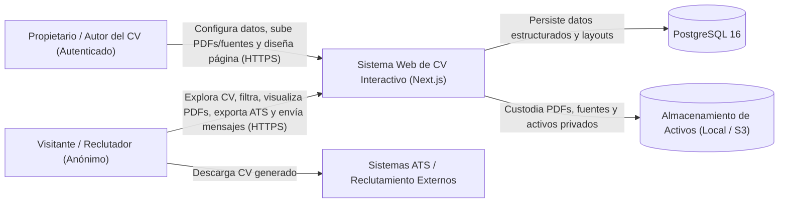
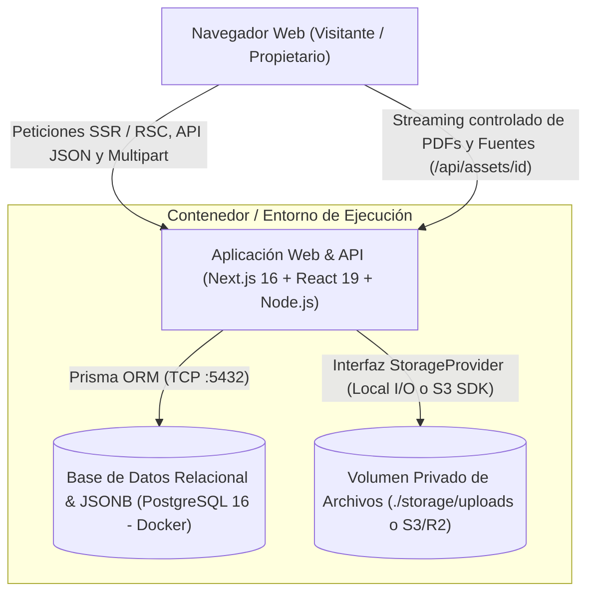

# 01 - Modelo C4 de Arquitectura

Siguiendo el modelo **C4 (Context, Containers, Components, Code)** de Simon Brown, se describe el sistema de lo macro a lo micro.

---

## Nivel 1: Diagrama de Contexto del Sistema

Muestra los actores externos y los límites del sistema completo.



---

## Nivel 2: Diagrama de Contenedores

Detalla las unidades de ejecución y almacenamiento que componen el sistema.



### Responsabilidad de cada Contenedor
| Contenedor | Tecnología | Responsabilidad |
| :--- | :--- | :--- |
| **Aplicación Web & API** | Next.js 16 (App Router), React 19, TypeScript | Sirve la vista pública SSR/RSC, el panel `/admin`, el constructor `/studio`, los endpoints `/api/*` y la entrega autenticada/controlada de binarios. |
| **Base de Datos** | PostgreSQL 16 (Docker Compose) | Almacena usuarios, perfiles multi-tenant ready, trayectoria, certificaciones, mensajes, metadatos `FileAsset` (`SHA-256`) y versiones `PageLayout` en `JSONB`. |
| **Almacenamiento Privado** | `LocalStorageProvider` (`./storage/uploads`) | Guarda PDFs de certificaciones, fuentes tipográficas y bundles fuera de `public/`, sin exposición directa por URL estática. |

---

## Nivel 3: Diagrama de Componentes Internos (Monorepo Orientado a Servicios)

Descompone el artefacto de ejecución en su **Frontend/Gateway (`apps/web`)**, sus **6 Microservicios Lógicos (`services/*`)** y los **Paquetes Base (`packages/*`)**.

```mermaid
flowchart LR
    REQ["HTTP Request"] --> PROXY["Proxy Edge Guard (apps/web/src/proxy.ts)"]

    subgraph WEB["apps/web/src (@cv/web - UI & Gateway)"]
        PUB["Vista Pública (/ y /u/slug)"]
        LOGIN["Acceso Privado (/login)"]
        ADMIN["Control Center CMS (/admin/*)"]
        STUDIO["Studio Lienzo & IDE (/studio - Fase 2)"]
        GW["Route Handlers Gateway (/api/*)"]
    end

    subgraph SERVICES["services/*/src (Microservicios Lógicos Aislados)"]
        SAUTH["@cv/api-auth (login, JWT, guards, edge)"]
        SCV["@cv/api-cv (perfil, experiencia, edu, proyectos, skills)"]
        SCERTS["@cv/api-certifications (bóveda metadatos PDF)"]
        SVAULT["@cv/media-vault (StorageProvider, magic bytes, /assets)"]
        SSTUDIO["@cv/api-studio (CanvasSchemaV1, Draft/Published, {{cv.*}})"]
        SCONTACT["@cv/api-contact (honeypot, rate-limit, mensajes)"]
    end

    subgraph PACKAGES["packages/*/src (Núcleo Compartido)"]
        PKGS["@cv/contracts · @cv/core · @cv/database (Prisma 6)"]
    end

    PROXY -->|@cv/api-auth/edge| SAUTH
    PROXY --> WEB
    PUB -->|getPrimaryPublishedShowcase| SCV
    ADMIN -->|getAdminOverviewCounts| SCV
    UI["Login / Admin / Studio"] --> GW

    GW --> SAUTH
    GW --> SCV
    GW --> SCERTS
    GW --> SVAULT
    GW --> SSTUDIO
    GW --> SCONTACT

    SCERTS -->|Validación y custodia| SVAULT
    SAUTH --> PKGS
    SCV --> PKGS
    SCERTS --> PKGS
    SVAULT --> PKGS
    SSTUDIO --> PKGS
    SCONTACT --> PKGS
```

---

## Nivel 4: Mapeo al Código y Servicios del Monorepo

| Paquete / Servicio | Ubicación Real en el Repositorio | Estado Actual |
| :--- | :--- | :--- |
| **Frontend + API Gateway** | `apps/web/src/{app,components,proxy.ts}` (`@cv/web`) | Implementado (Fase 1; `/studio` UI en Fase 2) |
| **Servicio Auth & Edge** | `services/api-auth/src/{routes,services,repositories,schemas,edge.ts}` | Implementado + tests unitarios |
| **Servicio Perfil y Carrera** | `services/api-cv/src/{routes,repositories,schemas}` | Implementado + tests unitarios |
| **Servicio Certificaciones** | `services/api-certifications/src/{routes,repositories,schemas}` | Implementado + tests unitarios |
| **Servicio Bóveda Binaria** | `services/media-vault/src/{routes,storage,validators,repositories}` | Implementado + tests unitarios |
| **Servicio Studio & Plantillas** | `services/api-studio/src/{routes,engine,repositories,schemas}` | Implementado + tests unitarios |
| **Servicio Contacto** | `services/api-contact/src/{routes,repositories,schemas}` | Implementado |
| **Paquetes Base (`contracts`, `core`, `database`)** | `packages/{contracts,core,database}` (`schema.prisma`, `seed.ts`) | Implementado (`eslint` fuerza fronteras) |
