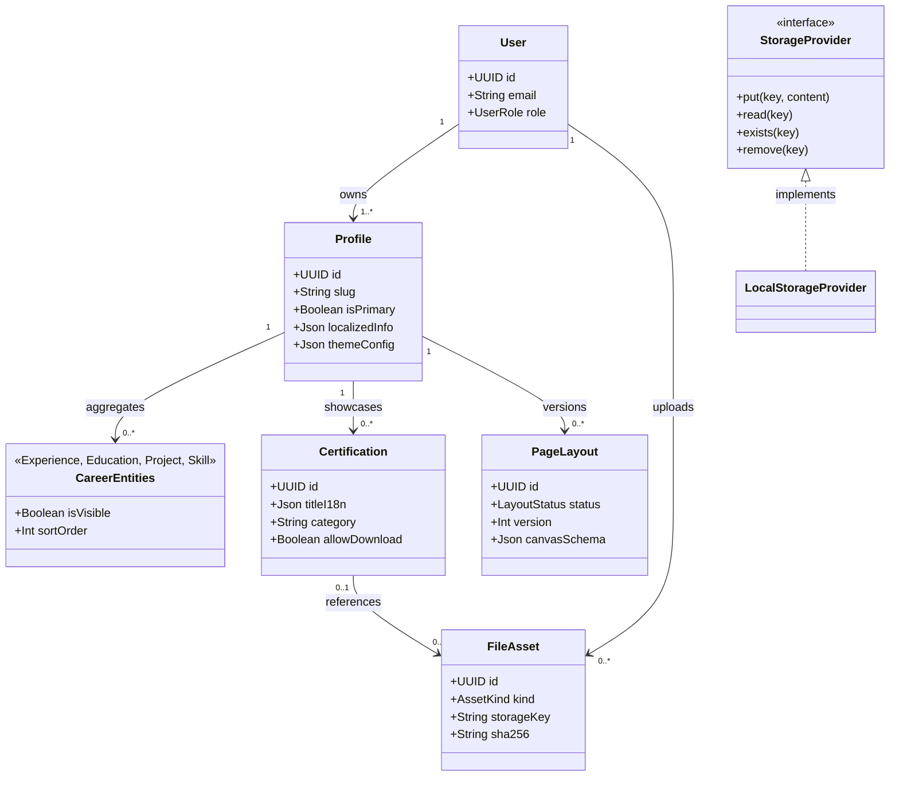
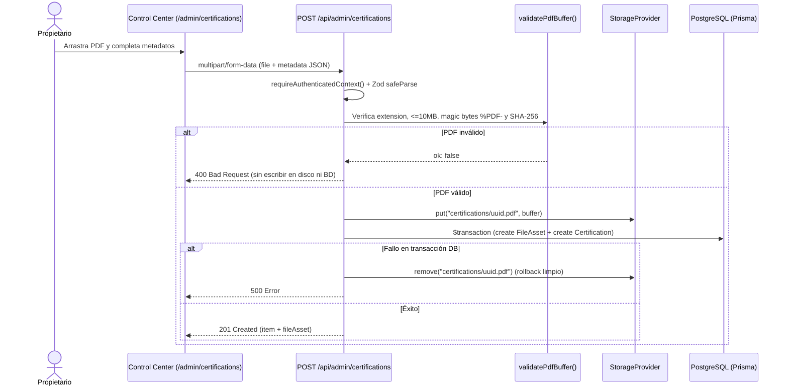
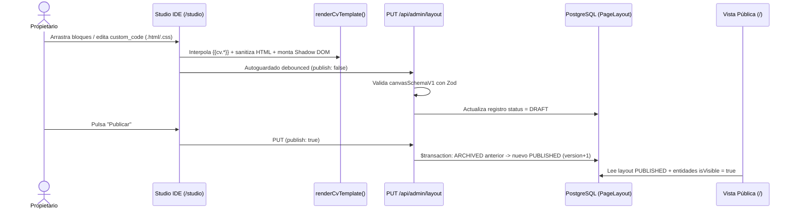
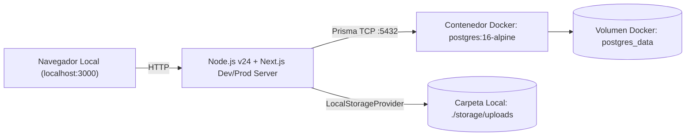
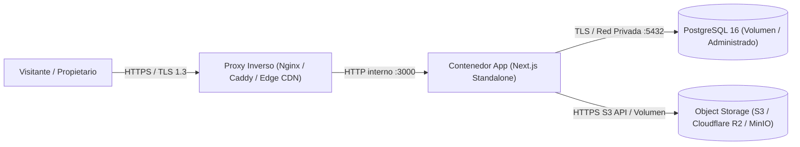

# 02 - Modelo de Vistas 4+1 (Kruchten)

El modelo **4+1** describe la arquitectura desde cinco perspectivas complementarias: **Lógica**, **Procesos**, **Desarrollo**, **Física (Despliegue)** y **Escenarios (+1)**.

---

## 1. Vista Lógica

Representa la descomposición estructural del dominio y las abstracciones principales que resuelven los requisitos funcionales sin acoplar la presentación visual a los datos persistidos.



### Principios de la Vista Lógica
- **Desacoplamiento Datos vs. Lienzo:** `CareerEntities` y `Certification` no dependen de `PageLayout`; el renderizador público hidrata los widgets (`widget_hero`, `widget_projects`, `widget_certifications`, `widget_cert_spotlight`) e interpola variables `{{cv.*}}` en nodos `custom_code` al momento de servir la vista.
- **Estado Bilingüe Universal:** Todos los campos editoriales se modelan como `{ es, en }` y se resuelven con respaldo (*fallback*) determinístico en `packages/core/src/locale.ts`.

---

## 2. Vista de Procesos (Concurrencia y Flujos Dinámicos)

### 2.1 Flujo Seguro de Subida y Entrega de Certificaciones PDF (`CU-01`)



### 2.2 Flujo de Edición en Studio IDE, Plantillas `{{cv.*}}` y Publicación (`CU-02`)



---

## 3. Vista de Desarrollo (Organización en Monorepo por Servicios)

Muestra la organización física en `pnpm workspaces` y sus reglas de dependencia unidireccionales verificadas por `eslint.config.mjs` (`apps/web` -> `services/*` -> `packages/*`):

```text
proyecto-cv/
├── apps/
│   └── web/                      # @cv/web: Frontend Next.js + API Gateway delgado
│       ├── next.config.ts
│       └── src/
│           ├── proxy.ts          # Guarda Edge delegando en @cv/api-auth/edge
│           ├── components/       # Componentes UI cliente reutilizables
│           └── app/              # Páginas SSR/UI + montajes REST delgados /api/*
├── services/                     # Microservicios lógicos aislados por dominio
│   ├── api-auth/src/             # @cv/api-auth: login/logout/me, JWT, bcrypt, guards
│   ├── api-cv/src/               # @cv/api-cv: perfil, carrera, portafolio, showcase SSR
│   ├── api-certifications/src/   # @cv/api-certifications: bóveda de certificados PDF
│   ├── media-vault/src/          # @cv/media-vault: StorageProvider, magic-bytes, /assets
│   ├── api-studio/src/           # @cv/api-studio: CanvasSchemaV1, Draft/Published, {{cv.*}}
│   └── api-contact/src/          # @cv/api-contact: anti-spam honeypot + bandeja CMS
│       # Estructura interna estándar de cada servicio:
│       # ├── index.ts (única puerta pública), routes/, repositories/, schemas/, tests/
├── packages/                     # Kernel técnico compartido (dependencia hacia abajo)
│   ├── contracts/src/            # @cv/contracts: primitivas Zod e interfaces comunes
│   ├── core/src/                 # @cv/core: env, HTTP helpers, rate-limit, i18n
│   └── database/                 # @cv/database: schema.prisma, seed.ts y cliente Prisma
└── docs/                         # SRS, SAD, ADRs, SDD, Modelo de Datos, APIs y UI/UX
```

---

## 4. Vista Física / Despliegue

### 4.1 Topología Local de Desarrollo (Activa en Fase 1)



### 4.2 Topología Objetivo en Producción (VPS o Nube)



---

## 5. Vista de Escenarios (+1)

Valida que las cuatro vistas anteriores satisfacen los escenarios críticos del sistema:

| Escenario | Vistas Involucradas | Atributo de Calidad Verificado |
| :--- | :--- | :--- |
| **E1: Visitante intenta acceder a `/admin` o `/api/admin/*` sin cookie válida** | Desarrollo (`proxy.ts`, `guards.ts`) + Procesos | **Seguridad (`RNF-SEC-01`):** Edge redirige a `/login` y API responde `401 Unauthorized` antes de tocar la BD. |
| **E2: Propietario sube un `.exe` o `.html` renombrado a `.pdf`** | Lógica (`validatePdfBuffer`) + Procesos (`CU-01`) | **Seguridad (`RNF-SEC-02`):** La inspección de *magic bytes* (`%PDF-`) rechaza el archivo con `400`; no se escribe en disco. |
| **E3: Propietario sube código HTML personalizado con `{{cv.profile.fullName}}` e intenta `<script>`** | Lógica (`template-engine.ts`) + Procesos (`CU-02`) | **Seguridad (`RNF-SEC-03`):** `renderCvTemplate` elimina `<script>`/`on*=`, escapa caracteres HTML en variables e instala el CSS en Shadow DOM aislado. |
| **E4: Migración de disco local a Cloudflare R2 / AWS S3 en producción** | Lógica (`StorageProvider`) + Física | **Portabilidad (`RNF-MAINT-02`):** Se implementa `S3StorageProvider` y se cambia `STORAGE_PROVIDER` sin modificar rutas API ni base de datos. |
| **E5: Activación de registro multi-usuario en fase futura** | Lógica (`userId`, `slug`) + Física | **Escalabilidad (`OBJ-06`):** Se habilita `ALLOW_SIGNUP=true` y ruta `/u/[slug]` reutilizando los índices y guardas por `userId` ya existentes. |
