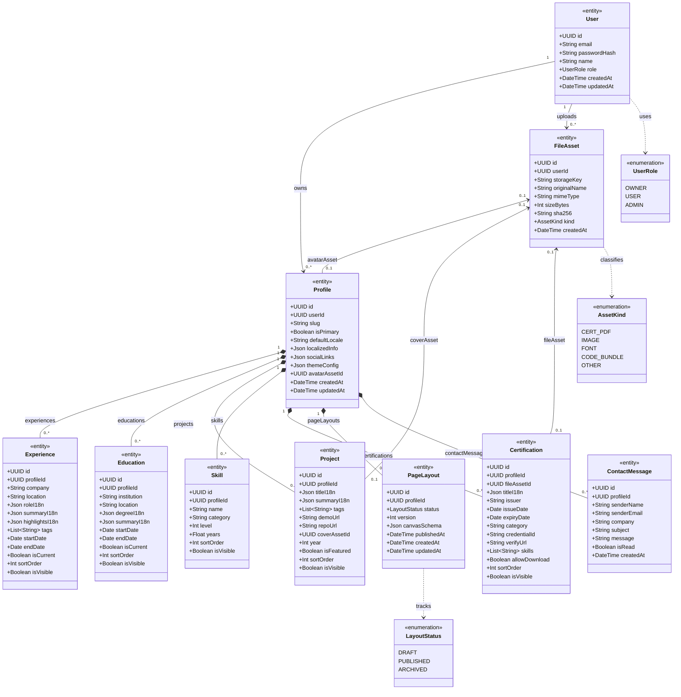
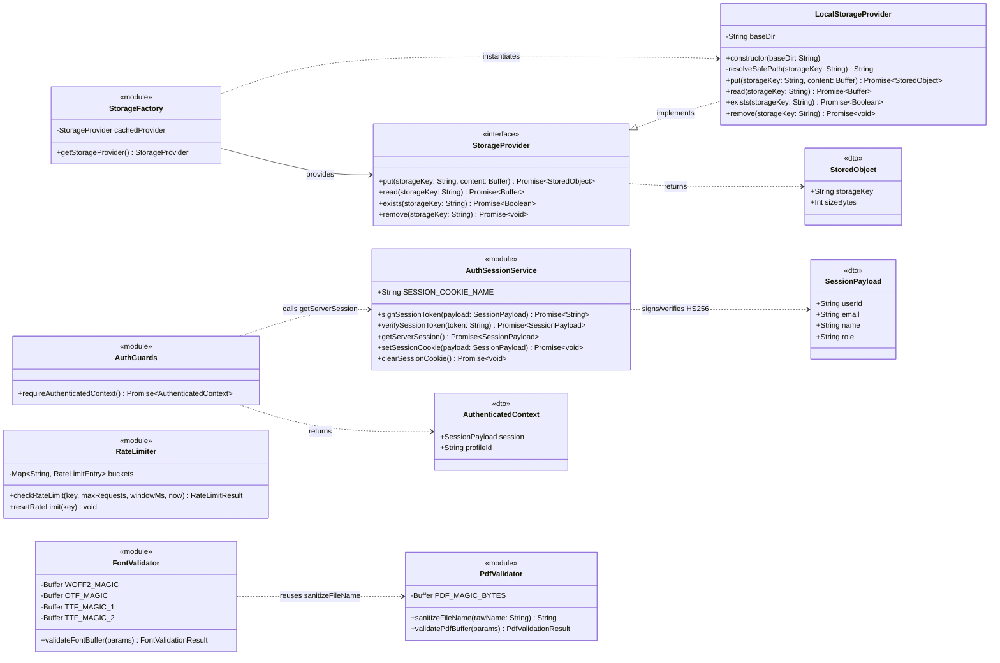
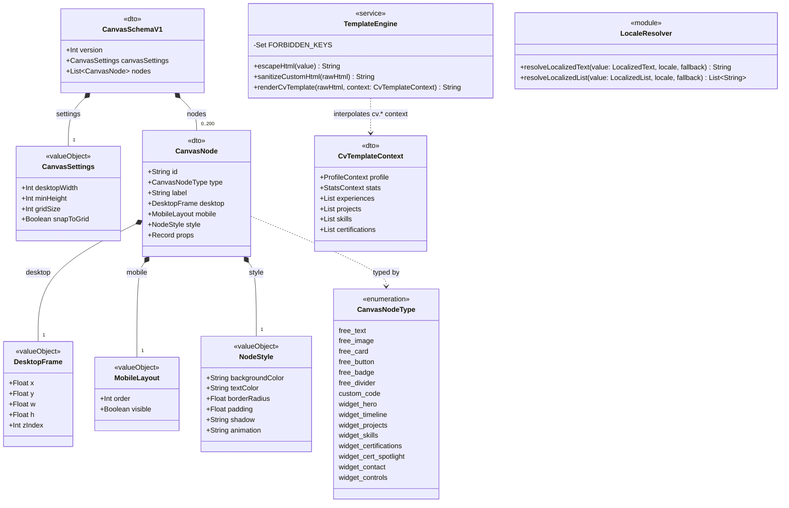

# 01 - Diagramas de Clases UML

Este documento modela la estructura estática del sistema en tres planos complementarios:
1. **Dominio y Persistencia** (`packages/database/prisma/schema.prisma`)
2. **Almacenamiento, Seguridad y Validación Binaria** (`services/media-vault/src/`, `services/api-auth/src/`)
3. **Lienzo Visual, Plantillas Seguras e Internacionalización** (`services/api-studio/src/`, `packages/contracts/src/`, `packages/core/src/`)

---

## 1. Modelo de Dominio y Persistencia (Prisma ORM -> PostgreSQL 16)

> **Estado:** Implementado en [schema.prisma](../../packages/database/prisma/schema.prisma).

---

## 2. Subsistema de Almacenamiento, Seguridad y Validación Binaria

> **Estado:** Implementado en [services/media-vault](../../services/media-vault/src/index.ts), [services/api-auth](../../services/api-auth/src/index.ts) y [packages/core](../../packages/core/src/index.ts).

---

## 3. Subsistema de Lienzo Visual, Plantillas Seguras e i18n

> **Estado:** Esquemas e interpolación implementados en [services/api-studio](../../services/api-studio/src/index.ts) y [packages/core](../../packages/core/src/locale.ts).

