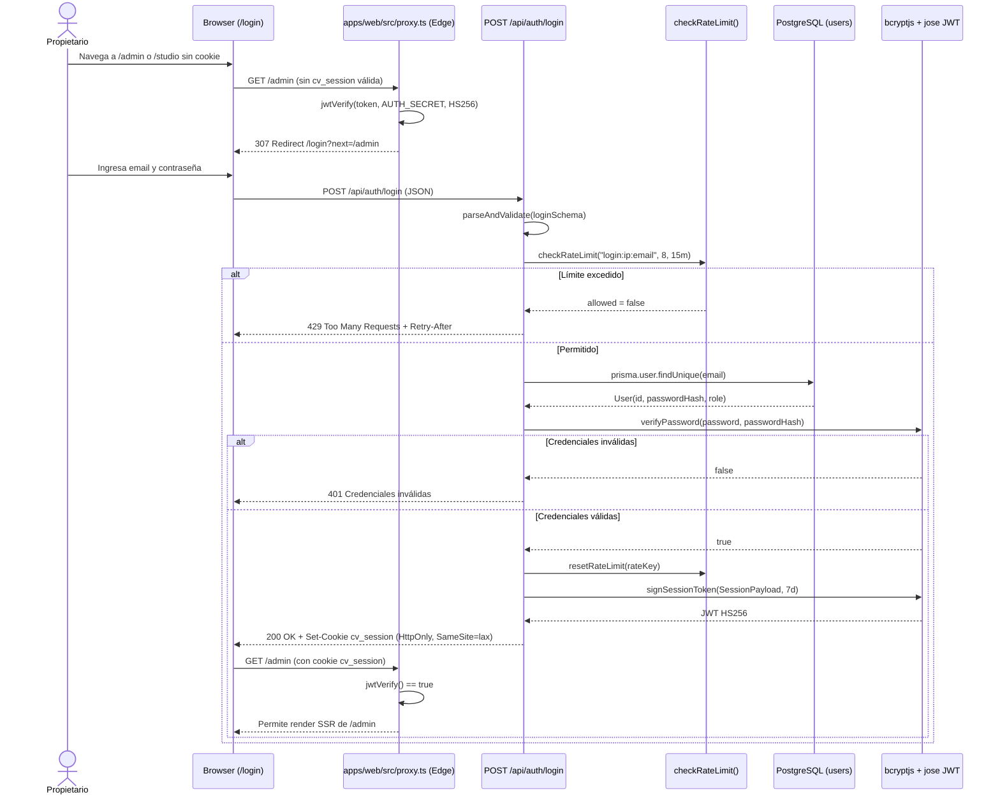
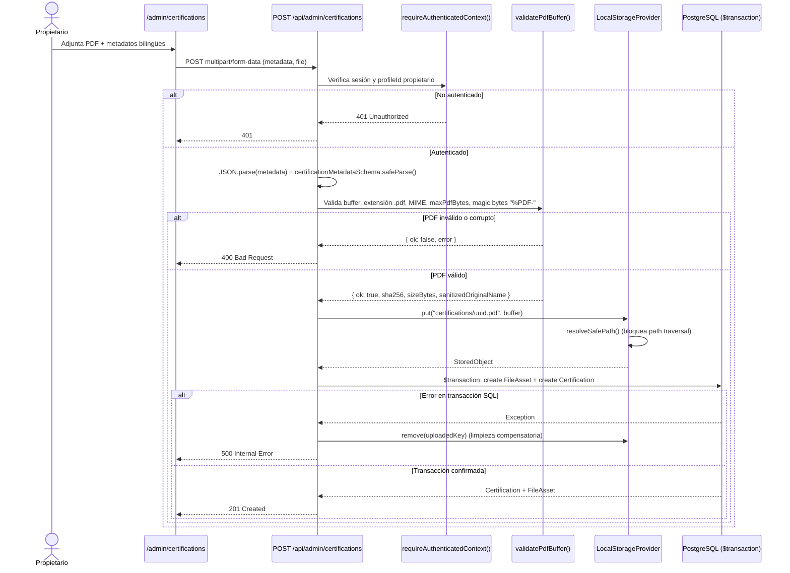
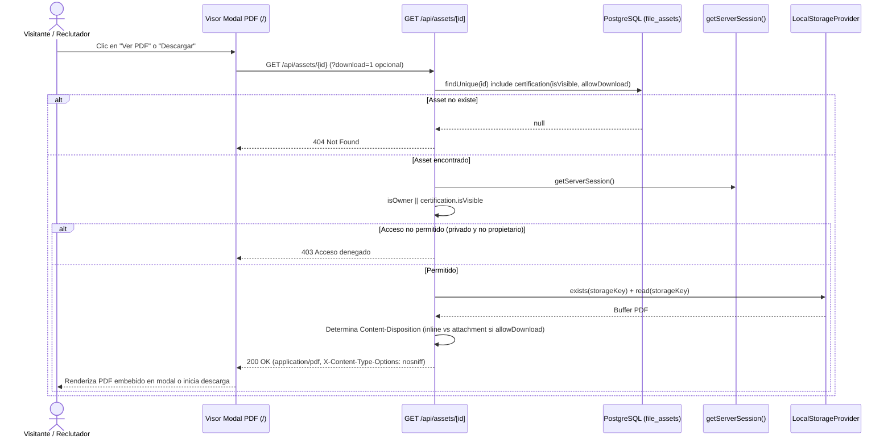
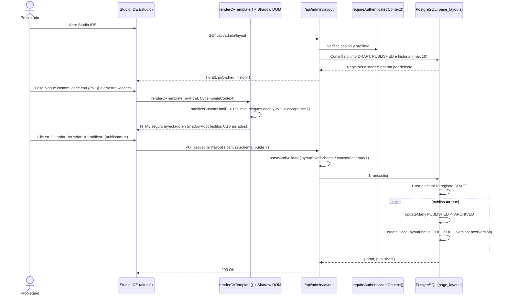
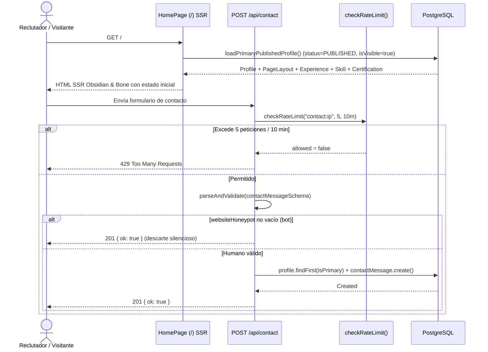
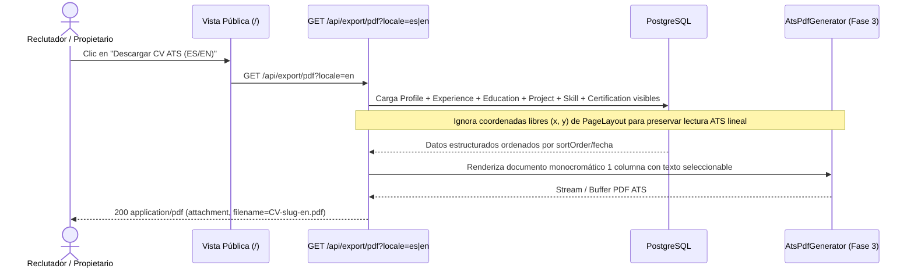

# 02 - Diagramas de Secuencia UML

Estos diagramas describen las interacciones temporales exactas entre actores, borde de seguridad, API REST, validadores, almacenamiento y PostgreSQL.

---

## 1. Autenticación y Acceso Protegido (`/login`, `/admin`, `/studio`)

> **Código asociado:** [apps/web/src/app/api/auth/login/route.ts](../../apps/web/src/app/api/auth/login/route.ts), [apps/web/src/proxy.ts](../../apps/web/src/proxy.ts), [services/api-auth](../../services/api-auth/src/index.ts), [packages/core/src/rate-limit.ts](../../packages/core/src/rate-limit.ts).

---

## 2. Subida Segura de Certificación y Archivo PDF (`POST /api/admin/certifications`)

> **Código asociado:** [apps/web/src/app/api/admin/certifications/route.ts](../../apps/web/src/app/api/admin/certifications/route.ts), [services/api-certifications](../../services/api-certifications/src/index.ts), [services/media-vault](../../services/media-vault/src/index.ts).

---

## 3. Consulta y Descarga Controlada de PDF en Bóveda (`GET /api/assets/[id]`)

> **Código asociado:** [apps/web/src/app/api/assets/[id]/route.ts](../../apps/web/src/app/api/assets/[id]/route.ts), [services/media-vault](../../services/media-vault/src/index.ts), [services/api-auth](../../services/api-auth/src/index.ts).

---

## 4. Edición en Studio IDE, Render Seguro `{{cv.*}}` y Publicación (`PUT /api/admin/layout`)

> **Código asociado:** [apps/web/src/app/api/admin/layout/route.ts](../../apps/web/src/app/api/admin/layout/route.ts), [services/api-studio/src/engine/template-engine.ts](../../services/api-studio/src/engine/template-engine.ts), [services/api-studio/src/schemas/canvas.schema.ts](../../services/api-studio/src/schemas/canvas.schema.ts).  
> **Nota:** El contenedor interactivo `/studio` en Next.js se implementa en Fase 2 sobre estos contratos y prototipo verificado.

---

## 5. Carga Pública del CV (`GET /`) y Envío de Contacto Anti-Spam (`POST /api/contact`)

> **Código asociado:** [apps/web/src/app/page.tsx](../../apps/web/src/app/page.tsx), [apps/web/src/app/api/contact/route.ts](../../apps/web/src/app/api/contact/route.ts), [services/api-contact](../../services/api-contact/src/index.ts).

---

## 6. Exportación de CV PDF en Formato ATS-Friendly *(Diseño Planificado — Fase 3)*

> **Estado:** Flujo objetivo definido por `RF-EXPORT-01..03` y `ADR-009` (pendiente de implementar el generador PDF en Fase 3).

