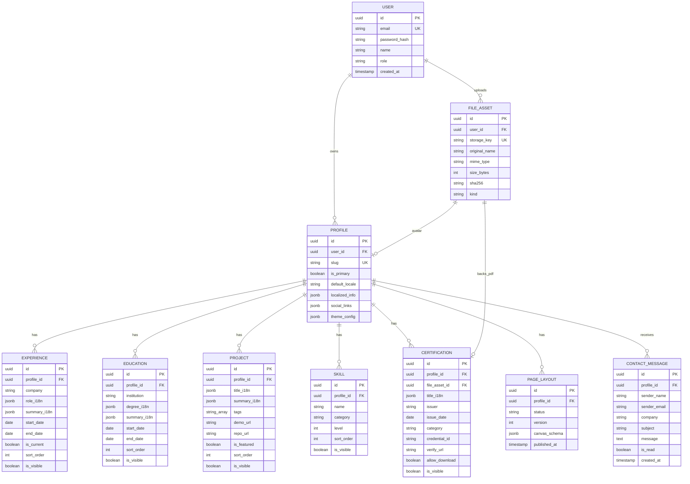
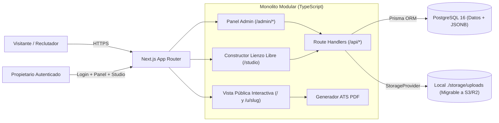

# 04 - Modelo de Datos y Arquitectura Técnica

---

## 1. Modelo Entidad-Relación

> **Referencia ampliada:** Consulta el [Diagrama ER físico completo y Diccionario de Datos](../modelo-datos/README.md) (sincronizado al detalle con `packages/database/prisma/schema.prisma`, índices compuestos y contratos `JSONB`) y el [Contrato OpenAPI 3.1](../api/openapi.yaml).

El modelo separa las entidades relacionales de negocio (perfil, experiencia, educación, proyectos, habilidades, certificaciones, archivos y mensajes) del documento visual JSONB (`PageLayout`), garantizando integridad referencial y preparación multi-usuario desde la primera migración.



---

## 2. Contrato del Lienzo Visual (`canvas_schema`)

Validado en servidor y cliente mediante `Zod`:

```json
{
  "version": 1,
  "canvasSettings": {
    "desktopWidth": 1200,
    "minHeight": 1400,
    "gridSize": 8,
    "snapToGrid": true
  },
  "nodes": [
    {
      "id": "node-hero-1",
      "type": "widget_hero",
      "label": "Hero Principal",
      "desktop": { "x": 48, "y": 48, "w": 1104, "h": 320, "zIndex": 1 },
      "mobile": { "order": 1, "visible": true },
      "style": {
        "backgroundColor": "surface",
        "borderRadius": 20,
        "padding": 24,
        "shadow": "md",
        "animation": "fade-up"
      },
      "props": {
        "showAvailabilityBadge": true,
        "showSocialLinks": true
      }
    }
  ]
}
```

### Tipos de Nodos Soportados
- **Elementos Libres y Código:** `free_text`, `free_image`, `free_card`, `free_button`, `free_badge`, `free_divider`, `custom_code` (HTML + CSS subido o editado en IDE, renderizado en Shadow DOM con interpolación segura `{{cv.*}}`).
- **Widgets Conectados a Capa 1:** `widget_hero`, `widget_timeline`, `widget_projects`, `widget_skills`, `widget_certifications`, `widget_contact`, `widget_controls`.
- **Activos Binarios (`AssetKind` en `FileAsset`):** `CERT_PDF`, `IMAGE`, `FONT` (`.woff2`/`.ttf`/`.otf`), `CODE_BUNDLE`, `OTHER`.

---

## 3. Arquitectura del Sistema



---

## 4. Estructura de Carpetas del Monorepo (`pnpm workspaces`)

```text
proyecto-cv/
├── apps/
│   └── web/                      # @cv/web: Frontend Next.js + API Gateway delgado
│       ├── next.config.ts
│       └── src/
│           ├── proxy.ts          # Guarda Edge delegando verificación en @cv/api-auth/edge
│           ├── components/       # Componentes UI cliente reutilizables
│           └── app/              # Páginas /, /login, /admin/*, /studio y gateway /api/*
├── services/                     # 6 microservicios lógicos aislados por dominio
│   ├── api-auth/                 # @cv/api-auth (src/ + tests/)
│   ├── api-cv/                   # @cv/api-cv (src/ + tests/)
│   ├── api-certifications/       # @cv/api-certifications (src/ + tests/)
│   ├── media-vault/              # @cv/media-vault (StorageProvider + magic bytes + tests/)
│   ├── api-studio/               # @cv/api-studio (CanvasSchemaV1 + template-engine + tests/)
│   └── api-contact/              # @cv/api-contact (src/)
├── packages/
│   ├── contracts/                # @cv/contracts: primitivas Zod e interfaces comunes
│   ├── core/                     # @cv/core: env, HTTP helpers, rate-limit, i18n
│   └── database/                 # @cv/database: prisma/schema.prisma, seed.ts y cliente Prisma
├── storage/uploads/              # Archivos binarios privados fuera de public/
├── docker-compose.yml            # Servicio PostgreSQL 16 para desarrollo local
├── pnpm-workspace.yaml
└── package.json
```

---

## 5. Estrategia de Migración a Multi-Usuario (Fase Futura)

Para activar el modo SaaS Multi-Usuario en el futuro sin reescribir la base de datos:
1. Cambiar `ALLOW_SIGNUP=true` en variables de entorno y habilitar ruta `/register`.
2. Al crear un nuevo usuario, generar automáticamente su `Profile` con un `slug` único.
3. Mantener `/` apuntando al perfil configurado como `PRIMARY_PROFILE_SLUG` (o landing de plataforma) y servir cada portafolio público en `/u/[slug]`.
4. Cambiar `LocalStorageProvider` por `S3StorageProvider` implementando la misma interfaz `StorageProvider`.
