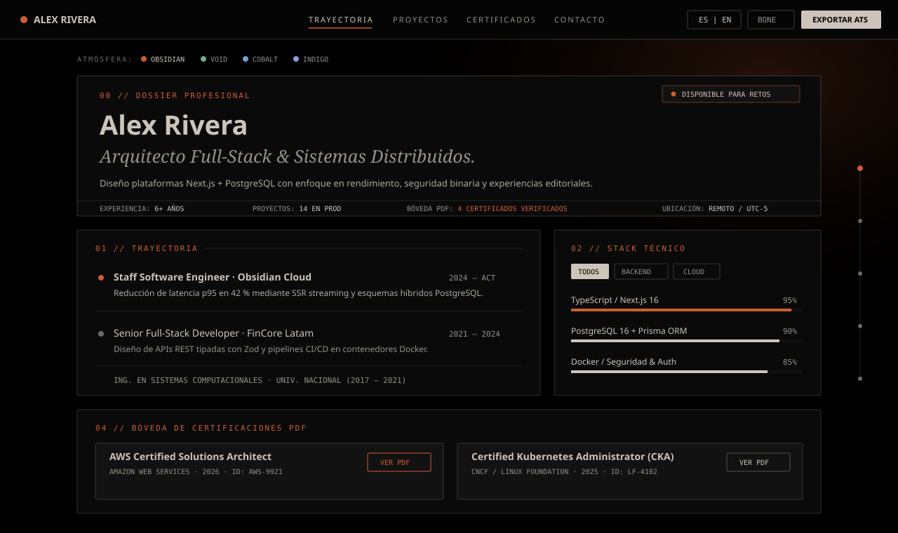
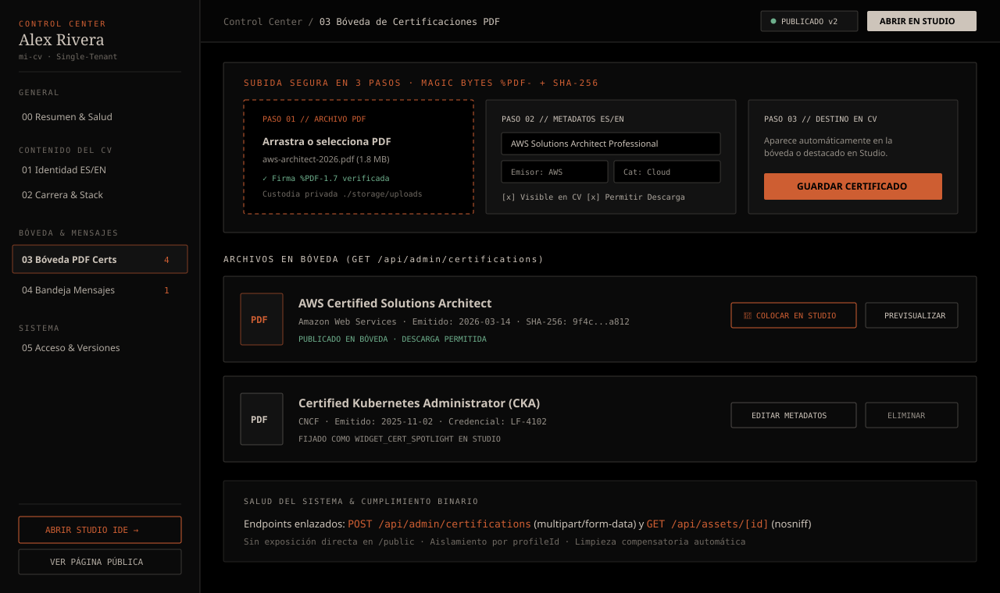
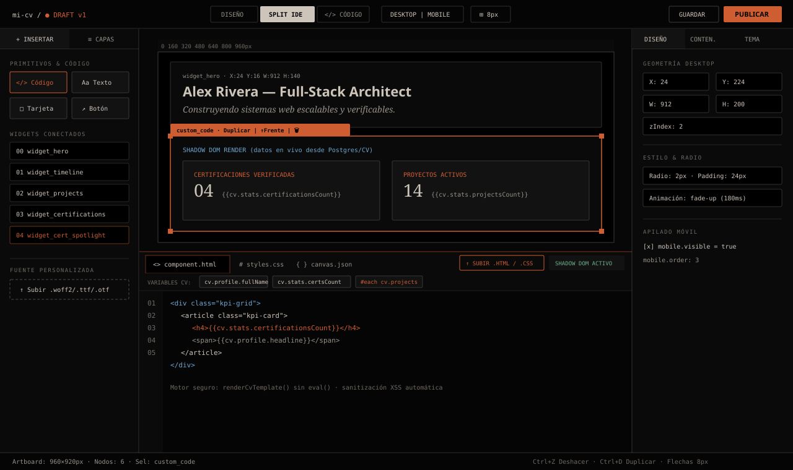
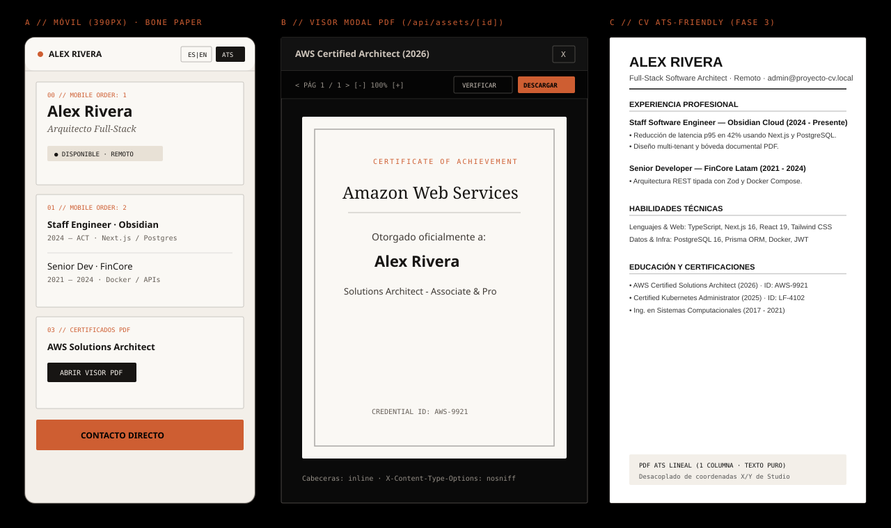
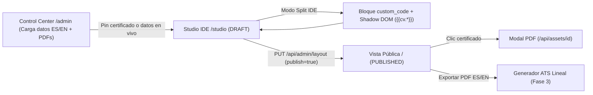

# 03 - Mockups de Alta Fidelidad y Flujos de Interacción

Este documento reúne los **mockups visuales de alta fidelidad** generados en formato vectorial SVG siguiendo exactamente los tokens de [01 - Guía de Estilo](./01-guia-de-estilo.md), junto con la matriz de estados de interfaz previa a la implementación de las vistas en Next.js.

> **Prototipo Interactivo Navegable:** Para probar arrastre real (*drag & resize*), modo `Split IDE` con código `{{cv.*}}` en vivo, cambio de atmósferas y visor modal PDF, abre [docs/prototipo/index.html](../prototipo/index.html) en tu navegador.

---

## 1. Mockup M-01: Vista Pública Editorial (`/`, Tema *Obsidian / Amaterasu*)

Incluye barra de navegación superior fija, selector de atmósferas (*Obsidian / Void / Cobalt / Indigo*), bloque Hero con tipografía `Fraunces` + `Space Grotesk`, tira de métricas (*Vitals Bar*), línea de tiempo interactiva, matriz de habilidades filtrable, bóveda de certificaciones PDF y *Spine* lateral de progreso.

---

## 2. Mockup M-02: Control Center CMS (`/admin/certifications`)

Muestra la organización con **Rail Lateral Izquierdo agrupado (`256px`)**, barra de contexto superior con estado `PUBLICADO`, flujo de subida segura en **3 pasos** (validación *magic bytes* `%PDF-` y `SHA-256`) y la acción puente **`Pin / Colocar en Studio`** (`widget_cert_spotlight`).

---

## 3. Mockup M-03: Studio Visual IDE en Modo `Split IDE` (`/studio`)

Representa el entorno de edición espacial con las 4 zonas dedicadas: barra de estado editorial (`DRAFT v1`), dock izquierdo (`+ Insertar`, `Capas`, carga de fuentes `.woff2`/`.ttf`/`.otf`), lienzo visual con regla y nodo `custom_code` seleccionado, panel inferior **Code Workbench** con subida de archivos `.html`/`.css` e inserción de variables `{{cv.*}}` bajo **Shadow DOM**, e inspector derecho (`Diseño / Contenido / Tema`).

---

## 4. Mockup M-04: Vista Móvil (*Bone Paper*), Visor PDF Modal y Salida ATS

Compara tres superficies clave del sistema:
- **A // Móvil (`390px`, tema claro *Bone Paper*):** reordenamiento limpio en 1 columna controlado por `mobile.order` y `mobile.visible`.
- **B // Visor Modal PDF (`/api/assets/[id]`):** visualización `inline` sin salir del CV, verificación de credencial y descarga controlada por `allowDownload`.
- **C // CV ATS-Friendly (Fase 3):** documento monocromático lineal de 1 columna optimizado para analizadores automáticos (*Applicant Tracking Systems*), desacoplado de coordenadas visuales del lienzo.

---

## 5. Flujo Completo de Diseño -> Publicación y Matriz de Estados UI

### Matriz de Estados Requeridos por Vista (Checklist para Implementación Fase 2–3)

| Vista / Componente | Estado Vacío (*Empty*) | Estado Cargando (*Loading*) | Estado Error | Estado Éxito |
| :--- | :--- | :--- | :--- | :--- |
| **Página Pública (`/`)** | Pantalla onboarding con pasos `docker compose`, `db:push`, `db:seed` (ya implementada en `apps/web/src/app/page.tsx`) | Skeleton de Hero y bloques preservando altura mínima | Fallback seguro sin exponer trazas SQL | Render SSR completo + filtros e idiomas reactivos |
| **Login (`/login`)** | Formulario limpio pre-enfocado en correo | Botón bloqueado con indicador `"Verificando..."` | Mensaje inline para `400`, `401` y cuenta regresiva `Retry-After` en `429` | Redirección al destino `?next=` o `/admin` |
| **Control Center (`/admin/*`)** | Invitación directa al formulario o dropzone de 3 pasos | Skeleton de filas / indicadores de subida | Alertas con detalle de campos `Zod` (`error.details`) o `%PDF-` inválido | Toast confirmatorio + actualización instantánea de listado |
| **Studio IDE (`/studio`)** | Opción `"Empezar desde cero"` vs `"Cargar Base Obsidian"` | Overlay sutil al cargar `GET /api/admin/layout` | Validación previa de `canvasSchemaV1` y `canvas.json` antes de enviar `PUT` | Badge `"Guardado en DRAFT"` / `"Publicado vN"` con historial |
| **Visor Modal PDF** | Estado deshabilitado si certificado no adjunta binario | Spinner técnico `Space Mono` mientras carga stream PDF | Mensaje `"Documento no disponible (403/404)"` con botón cerrar | Paginación, zoom y botón descarga condicionada |
